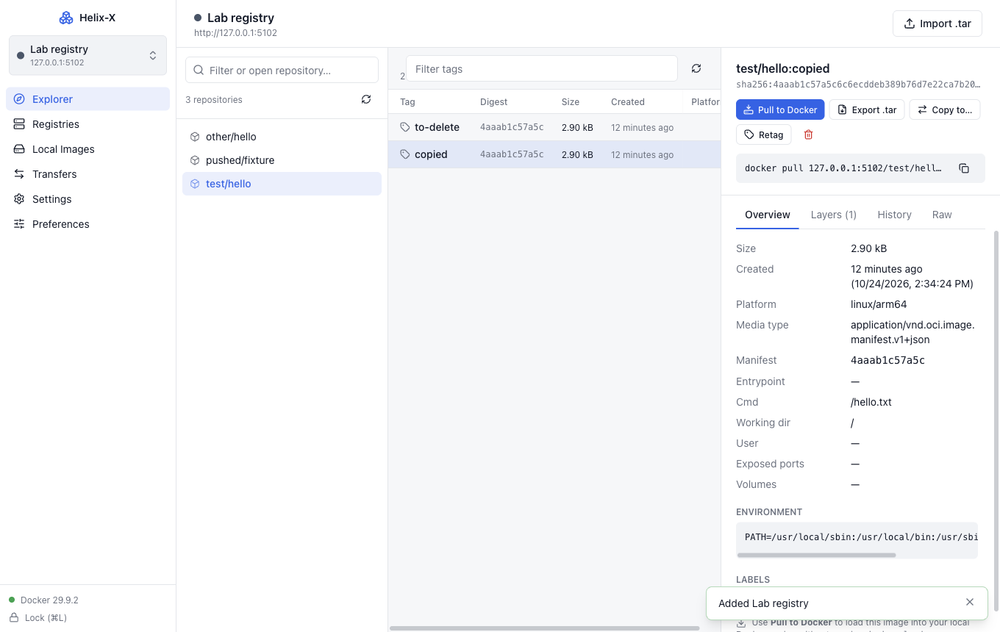

# Helix-X Docker Client

A cross-platform desktop app (macOS, Windows, Ubuntu/Linux) for working with **any container registry**:
connect with a URL and credentials, browse repositories, tags and manifests, and move images between
registries, `.tar` files and your **local Docker engine**. Docker Desktop does not need to be logged in
to the registry.



## Features

- **Secure credential vault.** A master password locks the app. Credentials are encrypted with AES-256-GCM using an Argon2id-derived key, with optional unlock via the OS keychain or Touch ID, and the vault auto-locks on idle or sleep.
- **Registry management (CRUD).** Add, edit, duplicate, delete, test, set a default, and switch registries with ⌘/Ctrl+K. Connections can be exported and imported, with credentials encrypted under a passphrase.
- **Import `docker login` credentials.** Registries you already signed in to with the docker CLI (config.json and credential helpers) can be imported in one step.
- **Supported registries.**
  - Generic and custom Registry v2 / OCI
  - Docker Hub
  - Harbor, Sonatype Nexus, JFrog Artifactory
  - Amazon ECR
  - Google Artifact Registry / GCR
  - Azure ACR
  - GitHub (GHCR)
  - GitLab
  - Each connection has its own TLS options: custom CA, skip verification, or plain HTTP.
- **Registry explorer.**
  - Lists repositories, falling back to pinning or opening a repository by name when listing isn't allowed.
  - Tag table with size, creation date, digest and platforms.
  - Manifest details: layers, history, environment, labels, and raw JSON.
  - Multi-architecture platform picker.
  - Retag, delete, and copy the pull command.
- **Pull to Docker.** The app downloads an image with the credentials you saved and loads it into the local Docker engine, where it appears in `docker images` and Docker Desktop. Preferences shows where Docker stores images on your machine.
- **Export and import.**
  - Export an image to a `.tar` file that `docker load`, podman, skopeo and crane can read.
  - Import a `.tar` (`docker save` output or an OCI layout) into any registry.
  - Push local Docker images to a registry.
  - Copy images between registries, one platform or all of them; cross-repository mount is used within the same registry.
- **Transfers.** A background job queue with progress, cancel and retry, plus a digest-verified layer cache. Transient network errors are retried automatically, interrupted downloads resume where they stopped, and system notifications and dock/taskbar progress report status.
- **Built-in Help.** The user guide, registry setup, troubleshooting and security docs are available offline inside the app (sidebar → Help, F1), with a per-provider setup guide in the Add registry dialog.
- **Settings and preferences.**
  - Proxy and trusted CA certificates
  - Docker endpoint override
  - Concurrency, cache size and log level
  - Theme (light, dark or system), density, date and size formats
  - Default platform and local tag style

## Repository layout

This is a **pnpm workspace** orchestrated by **Turborepo**:

```
apps/
  desktop/          @helix/desktop  Electron app: main entry, IPC, window/menu, preload, React UI,
                                    e2e tests, packaging (electron-builder.yml, resources/)
packages/
  core/             @helix/core     Engine with no Electron dependency: vault, stores, registry client
                                    and providers, Docker engine client, transfers, plus unit and
                                    integration tests
  shared/           @helix/shared   Types, IPC contract, zod schemas, registry provider definitions
  tsconfig/         @helix/tsconfig Shared TypeScript configs (base / node / web)
turbo.json          Task pipeline (build, typecheck, lint, test, test:integration, test:e2e, dist*)
```

`@helix/core` and `@helix/shared` are _internal packages_. They ship TypeScript source with no build
step, and electron-vite bundles them, along with every npm dependency, into `apps/desktop/out`. The
packaged app therefore contains no `node_modules`.

## Quick start

Requires Node 22+ and pnpm 11 (`corepack enable` picks up the pinned version).

```bash
pnpm install
pnpm dev             # start the desktop app with hot reload
```

On first launch you create a master password. Then add a registry under **Registries → Add registry**.

## Common tasks

```bash
pnpm check                 # turbo: typecheck + lint + unit tests in every package (cached)
pnpm build                 # turbo: production bundles
pnpm test                  # unit tests (vault crypto, auth parsing, archives, docker detection, IPC contract …)
pnpm test:integration      # starts registry:2 containers and exercises import/copy/export/pull/push/load (needs Docker)
pnpm test:e2e              # Playwright drives the built Electron app
pnpm --filter @helix/core test    # one package only
```

## Build binaries

```bash
./scripts/build.sh            # current OS (mac → .dmg/.zip, linux → .AppImage/.deb/.tar.gz)
./scripts/build.sh all        # macOS + Windows + Linux from a Mac
pnpm dist:mac | dist:win | dist:linux
```

Output goes to `apps/desktop/release/<version>/`. On Windows, use `scripts\build.ps1`.

**Releases** are one click: **Actions → Release → Run workflow** on `main` builds all three platforms,
publishes a GitHub Release with the installers, and bumps the version on `main`. Details, signing and
notarization are covered in [docs/building.md](docs/building.md#releasing).

## Documentation

| Document                                   | Contents                                       |
| ------------------------------------------ | ---------------------------------------------- |
| [User guide](docs/user-guide.md)           | Every screen and workflow                      |
| [Registry setup](docs/registries.md)       | Credentials and quirks for each provider       |
| [Architecture](docs/architecture.md)       | Processes, modules, data flow, file formats    |
| [Security](docs/security.md)               | Vault design, threat model, Electron hardening |
| [Building & releasing](docs/building.md)   | Toolchain, packaging, signing, CI              |
| [Troubleshooting](docs/troubleshooting.md) | Common errors and fixes                        |

## Why Electron?

We considered Tauri (Rust) and Wails (Go). Electron was chosen because:

- It has the most mature cross-platform packaging (dmg, NSIS, AppImage, deb) and auto-update ecosystem.
- `safeStorage` gives first-class OS keychain integration.
- The whole stack, UI and backend, is TypeScript.

The trade-off is a larger download, about 100 MB.

## License

MIT. See [LICENSE](LICENSE).
